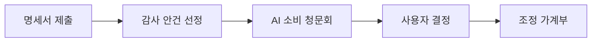
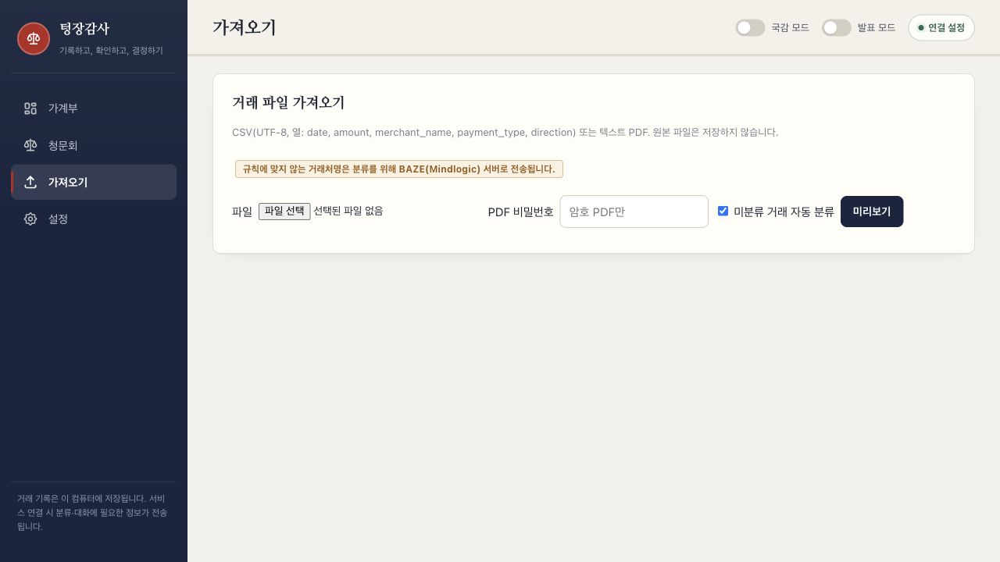
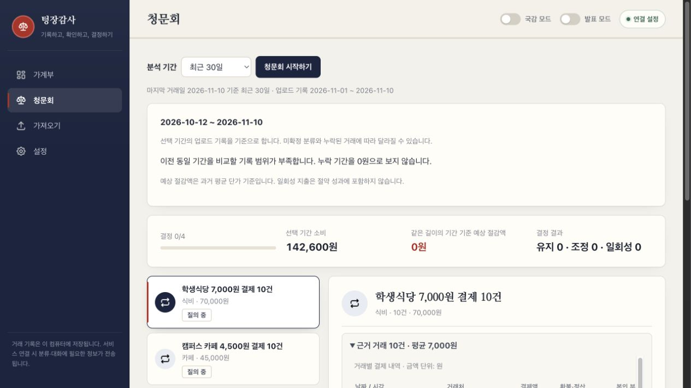
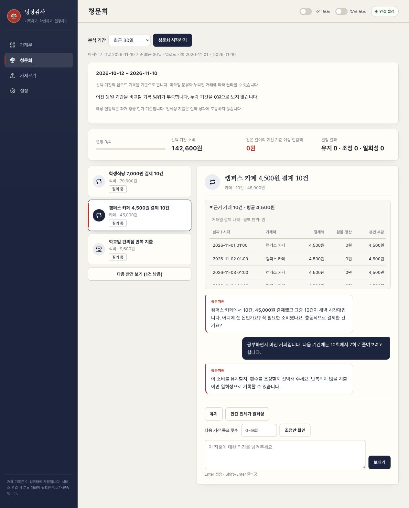
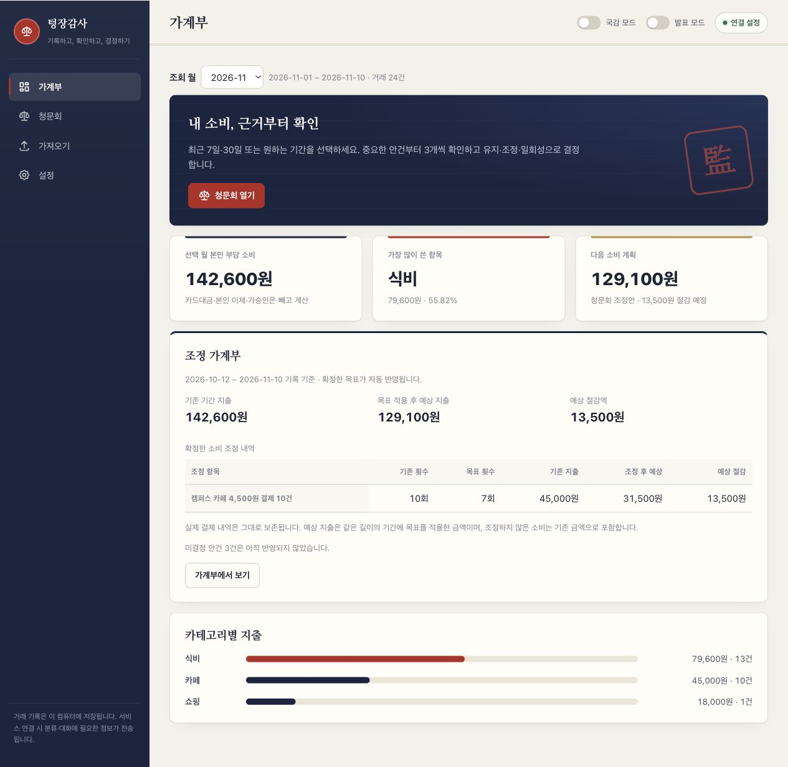
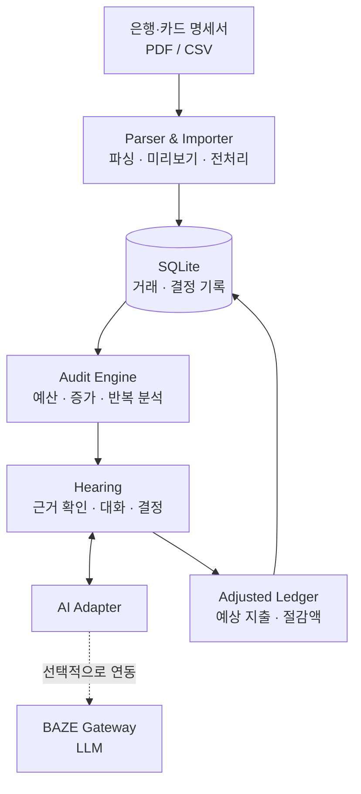

# 💸 텅장감사

### 당신의 소비, 이제 소명할 시간입니다.

**“이번 달 많이 쓰셨네요.” 그다음은요?**  
지출 내역을 *보고 끝내는* 가계부가 아니라, **소비의 이유를 묻고 다음 소비를 함께 결정하는 AI 소비 청문회.**

<br>

🏆 **2026 충남대학교 AWS Kiro 기반 AI 빌더스 챌린지 · 장려상**  
**TEAM T13 : 김종민, 박지훈, 이일우, 천재영**

<br>


**[프로젝트 소개](#about) · [사용 흐름](#how-it-works) · [DEMO](#demo) · [기술 구조](#architecture) · [실행하기](#getting-started)**

[GitHub Repository](https://github.com/Leeilwoo0309/kiro) · [Kiro 프로젝트 요구사항](.kiro/specs/ai-household-ledger/requirements.md)

</div>

## 프로젝트 소개

> **“카페에서 5번 결제했네. 줄여야겠다.”**  
> 그런데 그중 일부가 **점심 대신 마신 음료**였다면요?

기존 가계부는 **얼마나 썼는지**는 잘 보여줍니다. 하지만 같은 금액이라도 그 소비가 필요했는지, 일회성 지출인지, 앞으로 줄일 수 있는지는 사용자의 사정을 듣지 않고 알기 어렵습니다.

우리는 여기서 질문을 바꿨습니다.

**“얼마나 썼지?” → “왜 썼고, 다음에는 어떻게 쓸까?”**

| 일반적인 지출 분석 | 텅장감사의 접근 |
| :-- | :-- |
| 카테고리별 합계와 그래프를 보여줍니다. | **거래 기록을 근거로** 점검할 소비 안건을 제시합니다. |
| 지출 증가를 알립니다. | **사용자의 설명을 듣고** 지출의 맥락을 확인합니다. |
| 조언을 확인하고 끝납니다. | **사용자가 조정안을 확정**하고, 월별 점검을 마치면 다음 달 예산으로 저장할 수 있습니다. |

즉, 텅장감사는 **AI가 대신 혼내는 서비스가 아닙니다.**  
AI가 질문을 던지고, **판단과 결정은 사용자가 하는** 대화형 가계부입니다.

## How It Works



### 01. 명세서는 증거자료가 됩니다

은행, 카드 **PDF/CSV 명세서**를 불러오고, 거래를 미리 확인한 다음 계획에 반영합니다. 비밀번호로 보호된 PDF도 지원합니다.

AI가 참고하는 것은 막연한 인상이 아닙니다. **날짜, 거래처, 결제액, 환불, 정산, 실제 본인 부담액**처럼 확인 가능한 기록입니다.

### 02. AI가 묻고, 사용자가 소명합니다

예산 초과, 이전 동일 기간 대비 증가, 반복 지출을 바탕으로 안건을 제시합니다. 사용자는 결제가 왜 필요했는지 직접 설명할 수 있습니다.

### 03. 판정이 아니라, 선택입니다

AI가 목표 횟수를 제안하더라도 **최종 결정은 사용자에게** 있습니다.

- **유지** — 필요하다고 판단한 소비는 그대로 둡니다.
- **횟수 조정** — 목표 횟수를 직접 입력하거나 제안을 수락합니다.
- **일회성** — 반복적인 절약 대상으로 취급하지 않습니다.

### 04. 결정은 조정 가계부에 남습니다

확정한 선택에 따라 **기존 지출과 조정 후 예상 지출, 절감액**을 비교합니다. 실제 결제 원장은 변경하지 않으며, 저장한 목표는 재접속 후에도 확인할 수 있습니다. **월별 점검**에서는 모든 안건을 결정한 뒤 다음 달 예산으로 저장할 수 있습니다.


<a id="demo"></a>
## DEMO

아래 이미지는 실제 앱을 별도 데모 환경에서 실행해 촬영했습니다. 모든 거래는 가상 데이터이며, 청문회 캡처는 정형 질문과 직접 목표 입력 경로를 보여줍니다.

| STEP | 주요 화면 | 사용자가 하는 일 |
| :--: | :-- | :-- |
| **01** | **명세서 가져오기** | PDF/CSV 업로드 → 거래 미리보기 → 분류·누락 확인 → 원장 반영 |
| **02** | **기간 및 예산 설정** | 최근 7일·30일, 직접 지정한 기간 또는 월별 예산으로 점검 |
| **03** | **소비 청문회** | 거래 증거 확인 → AI 질문에 소명 → 조정 목표 논의 |
| **04** | **조정 가계부** | 유지·횟수 조정·일회성 확정 → 예상 지출과 절감액 확인 |

### 01. 명세서 가져오기



### 02. 점검 기간 선택



### 03. 거래 근거 확인과 소비 대화



### 04. 목표 확정 후 조정 가계부

카페 이용 목표를 **10회에서 7회**로 확정한 결과입니다. 카페 예상 지출은 **45,000원에서 31,500원**, 예상 절감액은 **13,500원**으로 표시됩니다.



**데모에서 확인할 포인트**

- **기록 기준 기간:** 최근 7일·30일은 오늘이 아니라 **업로드된 마지막 거래일**을 기준으로 계산합니다.
- **차근차근 검토:** 안건은 처음 3개부터 표시하고, 다음 안건을 3개씩 추가합니다.
- **근거 있는 질문:** 거래 시각이 있으면 **60분 이내 다른 거래처 결제**, 시각이 없으면 **같은 날 결제**를 참고합니다. 가까이 결제했다는 이유로 같은 품목을 구매했다고 단정하지 않습니다.
- **연결 실패에도 계속:** AI를 연결하지 않았거나 응답에 실패해도 정형 질문과 직접 선택으로 진행할 수 있습니다.
- **끊겨도 복원:** 메시지 전송이 실패하면 저장 여부를 확인하고, 저장되지 않은 입력을 복원합니다.

---

<a id="features"></a>
## Key Features

| 기능 | 구현한 방식 |
| :-- | :-- |
| **파일에서 가계부로** | PDF·CSV 파싱, 암호 PDF 지원, 미리보기 후 거래 반영 |
| **근거 기반 안건 선정** | 예산 초과 → 비교 가능한 기간의 지출 증가 → 반복 지출을 순서대로 점검 |
| **대화형 소비 청문회** | 첫 질문 생성, 사용자 설명 반영, 거래 근거 확인, 목표 횟수 제안 |
| **사용자가 확정하는 목표** | 유지 / 횟수 조정 / 일회성 선택 및 직접 입력 |
| **조정 가계부** | 결정 기록 저장, 예상 지출·절감액 계산, 원본 거래 보존 |
| **실패에 강한 흐름** | AI 미연결 시 대체 질문 제공, 전송 실패 시 미저장 입력 복원 |

---

<a id="architecture"></a>
## Tech Spec



**Backend**는 FastAPI로 로컬 API를 제공하고, **Frontend**는 빌드 과정 없이 동작하는 HTML·CSS·JavaScript로 구성했습니다. 거래·청문회·결정 기록은 **SQLite**에 저장하되, **실제 거래와 조정 결과는 구분**합니다.

| Layer | Stack | 역할 |
| :-- | :-- | :-- |
| **Frontend** | HTML · CSS · JavaScript | 명세서 확인, 청문회, 조정 가계부 |
| **Backend** | Python · FastAPI · Uvicorn | 로컬 서버 및 API |
| **Database** | SQLite | 거래·분류·청문회·결정 기록 |
| **AI** | BAZE Gateway · OpenAI Python SDK | 거래 분류 및 소비 맥락 대화 |
| **Parsing** | pdfplumber · pandas · chardet | PDF/CSV 파싱 및 전처리 |
| **Quality** | pytest · Node.js | 서버 로직 및 프런트엔드 회귀 검사 |
| **Icons** | Tabler Icons | 로컬 SVG 아이콘 |

> **AI가 없어도 핵심 흐름은 유지됩니다.** LLM 연결은 선택 사항이며, 연결되지 않은 상태에서도 명세서 가져오기·정형 질문·직접 결정·목표 저장을 사용할 수 있습니다.

---

<a id="getting-started"></a>
## 🚀 Getting Started

**macOS / Linux · Python 3 기준**

**1. 저장소를 클론하고 의존성을 설치합니다.**

```bash
git clone https://github.com/Leeilwoo0309/kiro.git
cd kiro
python3 -m venv .venv
.venv/bin/pip install -r requirements.txt
```

**2. 환경 설정 파일을 준비합니다.**

```bash
cp -n .env.example .env
```

`.env`에 `BAZE_API_KEY` 및 `LLM_MODEL`을 설정하거나, 앱 실행 후 설정 화면에서 연결할 수 있습니다. `cp -n`은 기존 `.env`를 덮어쓰지 않습니다.

**3. 앱을 실행합니다.**

```bash
.venv/bin/python -m app
```

브라우저에서 **http://127.0.0.1:8000** 에 접속하면 됩니다.

### 🧪 Testing

```bash
.venv/bin/python -m pytest -q
node --check app/static/app.js
```

해커톤 점검 당시 **테스트 82개 통과**. PDF 파싱, 청문회·조정안 처리, 사용자 메시지 표시, 전송 실패 시 입력 복원 등을 검사했습니다. Node.js가 없으면 프런트엔드 동작 테스트 일부는 건너뛸 수 있습니다. 자동화 테스트가 실제 브라우저 사용성과 외부 AI 응답 품질을 모두 보증하지는 않습니다.

<details>
<summary><b>📁 프로젝트 디렉터리 구조 펼쳐보기</b></summary>

<br>

```text
.
├── .kiro/specs/ai-household-ledger/  # Kiro 요구사항 문서
├── app/
│   ├── __main__.py        # 실행 진입점
│   ├── main.py            # FastAPI 라우트
│   ├── pdf_parser.py      # PDF 파싱
│   ├── csv_import.py      # CSV 파싱
│   ├── importer.py        # 거래 미리보기·가져오기
│   ├── preprocessor.py    # 전처리
│   ├── classifier.py      # 거래 분류
│   ├── audit.py           # 소비 안건 선정
│   ├── hearing.py         # 소비 청문회·조정안
│   ├── ledger.py          # 거래 원장
│   ├── forecast.py        # 예산·지출 전망
│   ├── ai_adapter.py      # AI 연결·응답 검증
│   ├── store.py           # SQLite 저장소
│   └── static/            # 웹 UI·SVG 아이콘
├── tests/                 # 회귀 검사
├── .env.example           # 환경 변수 예시
├── requirements.txt       # Python 의존성
└── readme.md
```

</details>

<details>
<summary><b>🔐 데이터 처리 및 구현 범위 확인하기</b></summary>

<br>

- **로컬 실행:** 서버는 `127.0.0.1`에서만 수신하는 단일 사용자용 MVP이며, 공개 배포용 서비스가 아닙니다.
- **기본 저장 위치:** 거래와 결정 기록은 `data/`의 SQLite에 저장합니다. `APP_DATA_DIR`로 위치를 변경할 수 있습니다.
- **AI 전송 데이터:** 외부 AI를 연결하면 분류·대화에 필요한 거래처명과 소비 정보가 해당 서비스로 전송됩니다.
- **개인정보 주의:** `.env`와 기본 데이터 폴더는 Git에서 제외됩니다. 별도로 보관한 명세서도 저장소에 커밋하지 마세요.
- **영구 삭제:** 설정의 '로컬 데이터 전체 삭제'는 거래·청문회 기록을 영구 삭제합니다.
- **파싱 한계:** 명세서 구조에 따라 PDF 인식 결과가 달라질 수 있습니다. 누락 거래와 미확정 분류는 직접 확인해야 하며, 업로드된 기록만으로 전체 거래 누락 여부를 보장하지 않습니다.
- **비교 및 추정:** 비교 기록이 부족하면 증가율을 계산하지 않습니다. 예상 절감액은 과거 평균 단가에 따른 추정치이며, 일회성 지출은 절약 성과에 포함하지 않습니다. 같은 거래를 여러 안건에서 중복 계산하지 않습니다.
- **기간 구분:** 최근 7일·30일·직접 지정 기간의 결과를 월 예산으로 자동 환산하지 않습니다.
- **원장 변경:** 거래 원장이 바뀌면 기존 청문회는 조회만 가능하며, 새로운 청문회를 시작해야 합니다.

</details>

---

<a id="team"></a>
## 🏆 Team T13 · Award

| | |
| :-- | :-- |
| **행사** | 2026 충남대학교 AWS Kiro 기반 AI 빌더스 챌린지 |
| **해커톤 주제** | AI로 만드는 더 나은 일상 — 내 주변의 사소하지만 진짜 불편한 문제를 AI로 해결하기 |
| **T13** | **올망졸망정말똘망** |
| **팀장** | **김종민**|
| **프로젝트** | **텅장감사** |

### Open Source Notice

[Tabler Icons v3.34.1](https://github.com/tabler/tabler-icons/tree/v3.34.1)의 SVG 아이콘 일부를 로컬에 포함했습니다. 아이콘은 **MIT License**를 따르며, [아이콘 라이선스 파일](app/static/icons/LICENSE)에서 확인할 수 있습니다.
